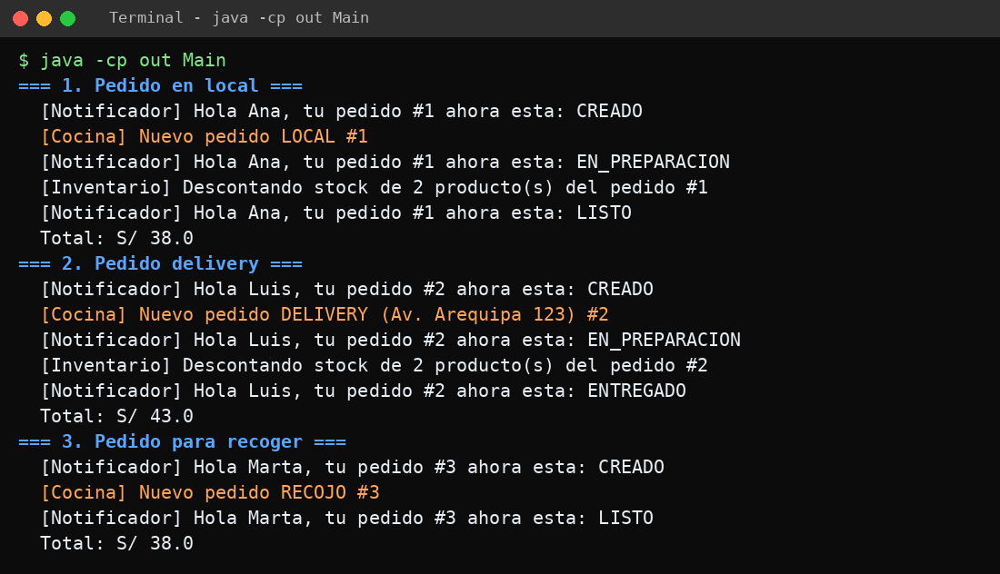
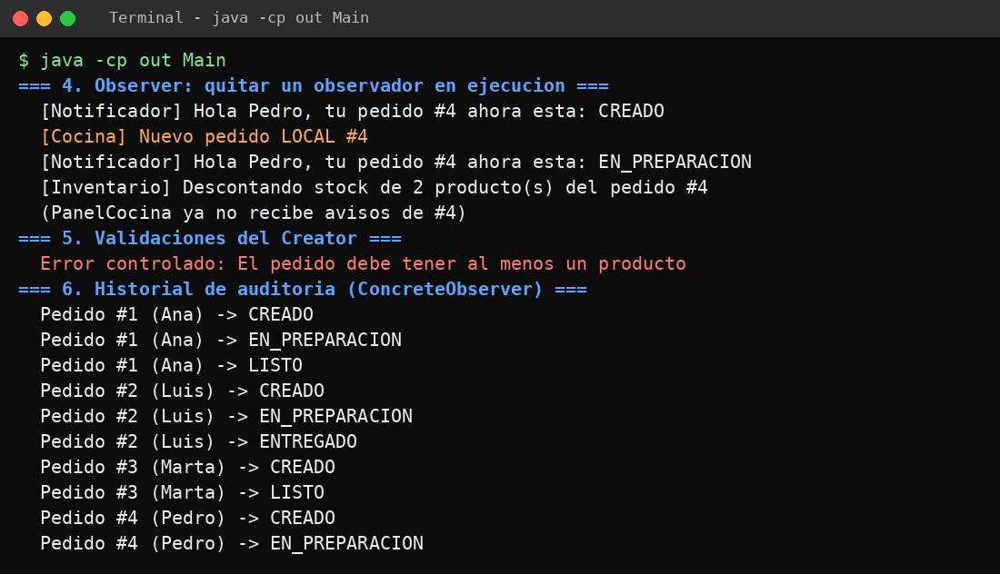

# SistemaPedidos

Proyecto Final - Diseño de Patrones (100000SI47) - 2026, Ciclo 2 Agosto  
Repositorio: `DP-2026-Grupo7-SistemaPedidos`  

## Integrantes

| Nombre | Código | Usuario de GitHub | Rol |
| --- | --- | --- | --- |
| Willy Loconi | U24208209 | [@ImGlitch70](https://github.com/ImGlitch70) | Desarrollador (Main, documentación) |
| Matías Pardo | U24208196 | [@mattiaspardofigueroacordova-gif] (https://github.com/mattiaspardofigueroacordova-gif).| Desarrollador (Factory Method) |
| Grabiel Olaya | U24219113 | [@lebrigrabielweb] | Desarrollador (Observer) |

## Problema que resuelve

Un restaurante/tienda recibe pedidos **en local, para recoger y delivery**. Cada tipo calcula costos
distintos y, cuando el estado de un pedido cambia, deben enterarse varias áreas (cliente, cocina,
inventario, auditoría). Sin un buen diseño, el código se llena de `if/else` por tipo de pedido y el
pedido queda acoplado a cada área interesada.

## Patrones aplicados

| Patrón | Tipo | Problema que resuelve | Clases que participan |
| --- | --- | --- | --- |
| Factory Method | Creacional | Crear distintos tipos de pedido sin `if/else` y sin modificar código existente al agregar uno nuevo | Creator: `PedidoCreator` · ConcreteCreator: `PedidoLocalCreator`, `PedidoDeliveryCreator`, `PedidoRecojoCreator` · Product: `Pedido` · ConcreteProduct: `PedidoLocal`, `PedidoDelivery`, `PedidoRecojo` |
| Observer | De comportamiento | Avisar automáticamente a cliente, cocina, inventario y auditoría cuando cambia el estado de un pedido, sin acoplarlos | Subject: `Sujeto` (implementado por `Pedido`) · Observer: `Observador` · ConcreteObserver: `NotificadorCliente`, `ControlInventario`, `PanelCocina`, `RegistroAuditoria` |

Ficha de cada patrón y comparación antes/después: [docs/fichas-patrones.md](docs/fichas-patrones.md)

## Diagrama de clases


## Cómo compilar y ejecutar

Requisitos: JDK 17 o superior.

```bash
# Desde la raíz del repositorio
mkdir out
javac -d out $(find src -name "*.java")     # Linux / macOS
java -cp out Main
```

En Windows (PowerShell):

```powershell
mkdir out
javac -d out (Get-ChildItem -Recurse src -Filter *.java).FullName
java -cp out Main
```

## Capturas de pantalla

Pedidos en local, delivery y recojo (Factory Method + Observer):



Desuscripción de un observador, validaciones del Creator y auditoría:



## Estructura

```
├── README.md
├── docs/            # diagrama, fichas de patrones, capturas y presentaciones
└── src/
    ├── Main.java
    ├── modelo/
    └── patrones/
        ├── factory/
        └── observer/
```
